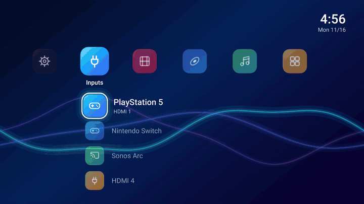
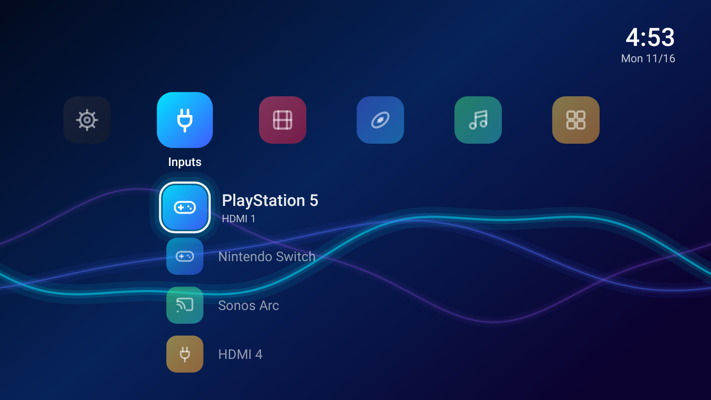
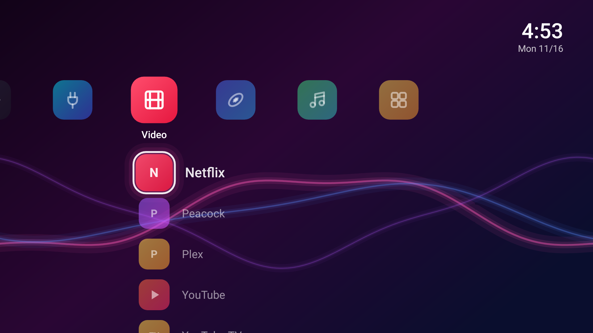
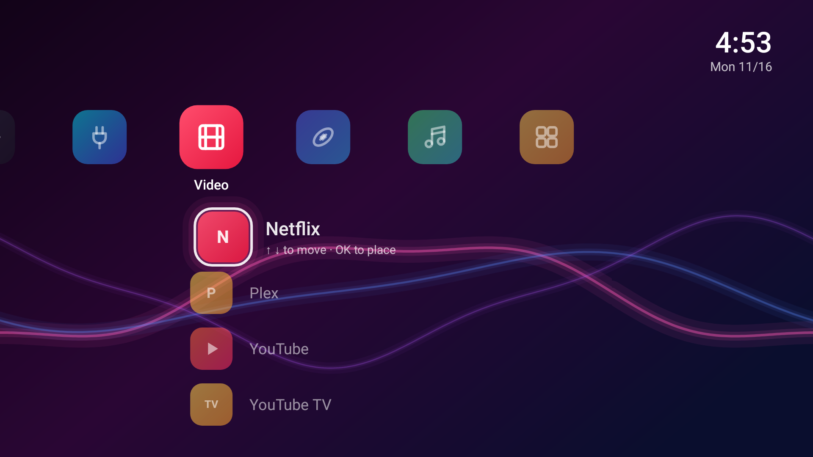
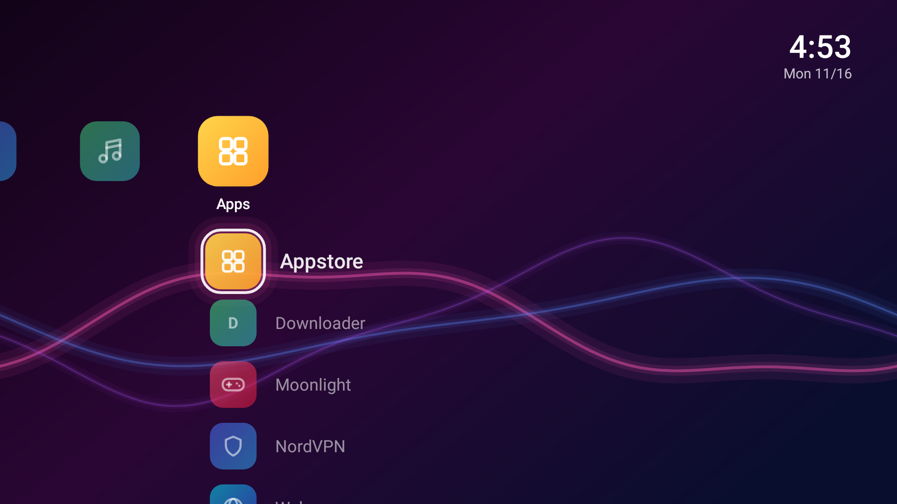
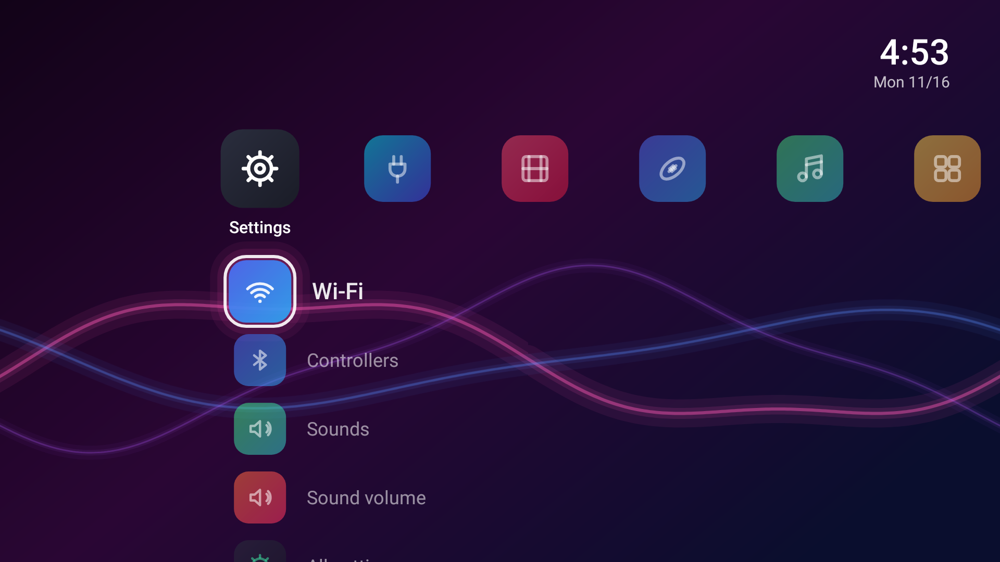
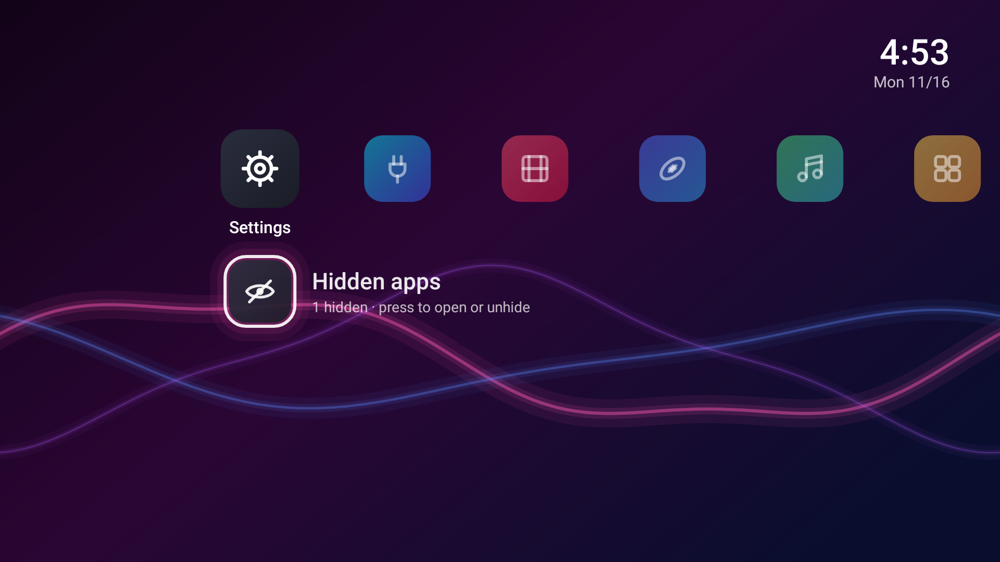

# Ribbon

A fast, minimal home screen for Fire TV, in the spirit of the classic cross-bar console menus: one row of categories, one column of items, smooth animated ribbons, and quick menu sounds.

Works on Fire OS 6 (Android 7.1) and newer, including Fire TV smart TVs and sticks.



## Screenshots

| | |
|---|---|
|  |  |
| **Inputs**: HDMI devices, consoles first | **Video**: streaming apps, sorted in automatically |
|  |  |
| **Arrange it**: ☰ → Move, then ↑ ↓ | **Apps**: everything else, plus the web viewer |
|  |  |
| **Settings**: Wi-Fi, controllers, sounds | **Hidden apps**: out of sight, one click away |

The app names and HDMI devices in these shots are sample data.

## Features

- **Cross-bar home screen**: categories for Settings, Inputs, Video, Sports, Music and Apps. Installed apps are sorted in automatically, A–Z.
- **Arrange it your way**: press ☰ on any app to move it up or down, or hide it. Hidden apps stay out of sight; open or unhide them from Settings → Hidden apps. "Sort this tab A–Z" resets a tab. Your layout is saved on the TV.
- **Inputs**: switch to HDMI ports right from the home screen. Devices that announce themselves over HDMI-CEC show up by name.
- **Home button override**: Fire TV ignores the "default launcher" setting, so Ribbon reopens itself whenever Amazon's home screen comes up. "Amazon home" is still one click away in Settings.
- **Menu sounds**: original synthesized sounds (see `tools/make_sounds.py`), four volume levels. You can also drop in your own sound pack (see below).

## Privacy

- Ribbon has no accounts, analytics or tracking. Everything you set up stays on the TV.
- The Home button override is an accessibility service. It only listens for window changes from Amazon's launcher package and reads no screen content.

## Build

Requirements: Android Studio (or JDK 17+ and the Android SDK).

```bash
./gradlew assembleRelease
```

The APK lands in `app/build/outputs/apk/release/app-release.apk`. Release builds are signed with the local debug key, which is fine for sideloading. Use the release build day to day: debug builds expose a debugging inspector over ADB.

## Install on a Fire TV

1. On the TV, turn on **Settings → My Fire TV → Developer options → ADB debugging**. Note the TV's IP address under **About → Network**.
2. From your computer:

```bash
adb connect <tv-ip>:5555
adb install -r app/build/outputs/apk/release/app-release.apk
```

3. Turn on the Home button override (one time):

```bash
adb shell settings put secure enabled_accessibility_services dev.ribbon.launcher/.HomeOverrideService
adb shell settings put secure accessibility_enabled 1
```

4. Let Ribbon switch the override back on by itself after updates and reboots (recommended):

```bash
adb shell pm grant dev.ribbon.launcher android.permission.WRITE_SECURE_SETTINGS
```

5. Only if needed:
   - **Older Fire OS 6 devices**, where accessibility services never start. Ribbon falls back to watching app usage instead:

     ```bash
     adb shell appops set dev.ribbon.launcher GET_USAGE_STATS allow
     ```

   - **TCL Fire TVs**, which may block apps from starting at boot:

     ```bash
     adb shell appops set dev.ribbon.launcher AUTO_START allow
     ```

### Undo

```bash
adb shell settings delete secure enabled_accessibility_services
adb uninstall dev.ribbon.launcher
```

## Custom sound pack

Put any of these files in `/sdcard/Android/data/dev.ribbon.launcher/files/sounds/` on the TV:
`snd_move.wav`, `snd_category.wav`, `snd_select.wav`, `snd_back.wav`, `snd_edge.wav`.

If the folder has any of them, they replace the built-in set. Any sounds missing from the pack fall back to the built-in ones. For example:

```bash
adb push snd_move.wav /sdcard/Android/data/dev.ribbon.launcher/files/sounds/
```

Built-in sounds can be regenerated in four styles (`glass`, `ambient`, `digital`, `deep`):

```bash
python3 tools/make_sounds.py glass
```

## Remote

| Where | Button | Action |
| --- | --- | --- |
| Home | ← → | Switch category |
| Home | ↑ ↓ | Move through items |
| Home | OK | Open |
| Home | ☰ | Move or hide the selected app |
| Moving a tile | ↑ ↓, then OK | Slide it, then place it |

## Disclaimer

Ribbon is an independent hobby project. It is not affiliated with or endorsed by Amazon, Sony or any other company mentioned.

## License

[MIT](LICENSE)
